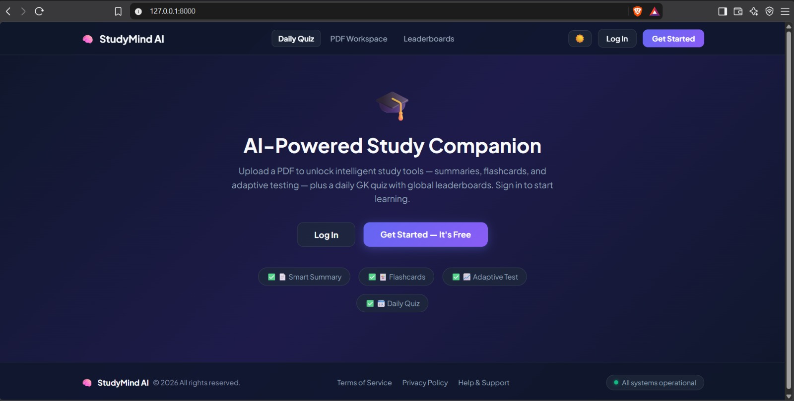
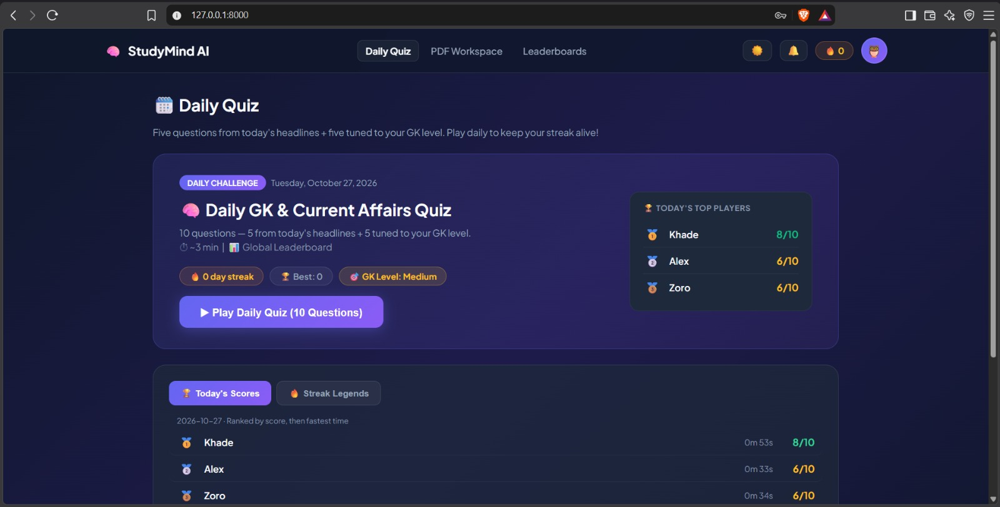
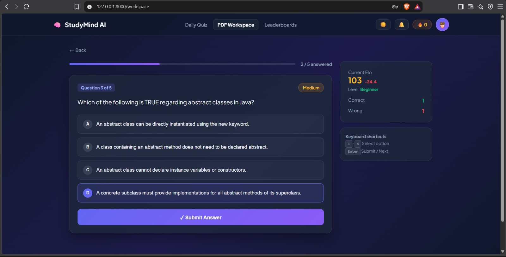
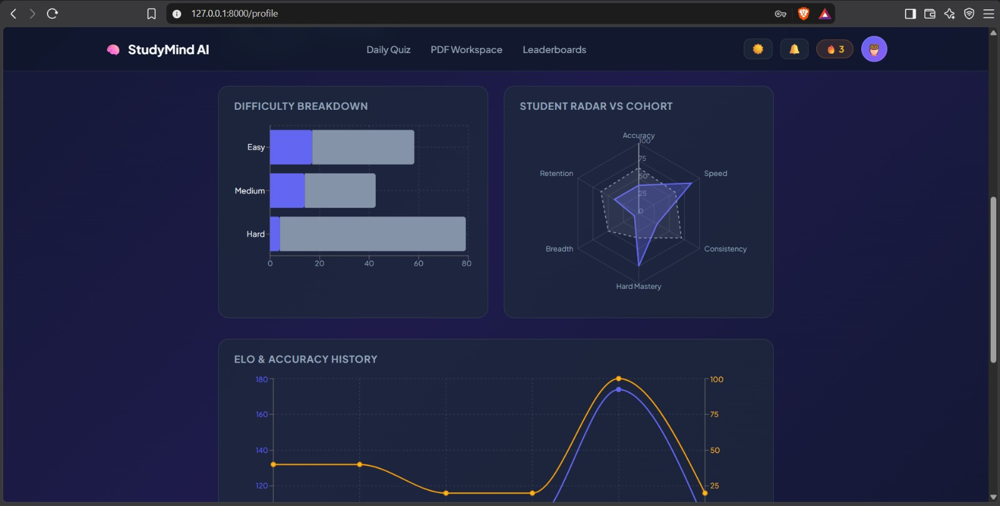

# AI-Powered Adaptive Study Platform

An adaptive learning platform where students upload their study material (PDFs), get quiz questions generated from it, take tests that adjust difficulty to their level, and compete with friends on leaderboards. Built as a Semester 3 team project.

## Features

- **PDF upload and parsing:** Upload study notes and extract their text.
- **AI-generated questions:** Quiz questions are generated from the uploaded material using Google Gemini.
- **Adaptive testing:** Difficulty adjusts to the student's ability using item-response-theory and rating engines.
- **Performance prediction:** A scikit-learn model classifies students as Beginner, Intermediate, or Advanced.
- **Daily quiz:** A new quiz is generated automatically every night at 00:00 IST using Celery.
- **Social features:** Add friends, challenge them to quizzes, and view leaderboards.
- **Analytics dashboard:** Track progress and performance over time.
- **Accounts:** Sign up and log in with JWT-based authentication.

## Tech Stack

- **Backend:** Python, Django, Django REST Framework, Simple JWT
- **Frontend:** React, Vite
- **Machine learning:** scikit-learn, pandas, joblib
- **Background jobs:** Celery, Redis
- **Database:** PostgreSQL hosted on Supabase
- **AI:** Google Gemini API

## Screenshots






## Project Structure

```
sem3-project/
├── frontend/       # React (Vite) frontend
├── mysite/         # Django project settings, URLs, Celery config
├── study_core/     # Main Django app: models, views, services, tasks
├── ml/             # Trained model, training notebook, and prediction code
├── requirements.txt
└── manage.py
```

## Getting Started

### Prerequisites

- Python 3.11 or newer
- Node.js 18 or newer
- A Supabase account (free tier works), used as the PostgreSQL database
- Redis (needed for the daily quiz and background tasks)
- A Google Gemini API key

### Database (Supabase)

1. Create a free project at [supabase.com](https://supabase.com).
2. Go to **Project Settings → Database** and copy the connection details.
3. Use the **Session pooler** host and port (`6543`) for `DB_HOST` and `DB_PORT`.
4. Use the database password you set when you created the project for `DB_PASSWORD`.

Never share your database password or commit it to GitHub.

### 1. Clone the repository

```bash
git clone https://github.com/atharvakhade2007-cyber/sem3-project.git
cd sem3-project
```

### 2. Set up the backend

```bash
python -m venv venv
source venv/bin/activate        # Windows: venv\Scripts\activate
pip install -r requirements.txt
```

### 3. Configure environment variables

Create a `.env` file in the project root:

```env
DJANGO_SECRET_KEY=your-long-random-secret
DJANGO_DEBUG=True
DJANGO_ALLOWED_HOSTS=localhost,127.0.0.1

DB_NAME=postgres
DB_USER=postgres.your-project-ref
DB_PASSWORD=your-supabase-database-password
DB_HOST=aws-0-your-region.pooler.supabase.com
DB_PORT=6543

REDIS_URL=redis://localhost:6379/0
GEMINI_API_KEY=your-gemini-api-key
```

Never commit your `.env` file.

### 4. Set up the database

```bash
python manage.py migrate
python manage.py createsuperuser
```

### 5. Run the backend

```bash
python manage.py runserver
```

### 6. Run the frontend (development)

```bash
cd frontend
npm install
npm run dev
```

### 7. Run the background worker (for the daily quiz)

In a separate terminal, with Redis running:

```bash
celery -A mysite worker -B --loglevel=info
```

## How It Works

1. A student uploads study material as a PDF.
2. The text is extracted, and Gemini generates questions from it.
3. The adaptive engine picks questions that match the student's current ability and updates their rating after each answer.
4. The ML model gives an initial performance prediction.
5. Each night, Celery generates a shared daily quiz for all users.

## Model

The performance predictor classifies a student's level as **Beginner**, **Intermediate**, or **Advanced** based on their quiz performance.

- **Dataset:** [sem-3 AI/ML dataset](https://www.kaggle.com/datasets/atharvakhade2011/sem-3-aiml-dataset)
- **Training notebook:** [sem3-aiml-project on Kaggle](https://www.kaggle.com/code/atharvakhade2011/sem3-aiml-project), also saved in [`ml/training/`](ml/training/)
- **Algorithm:** Gradient Boosting Classifier, inside a scikit-learn pipeline with median imputation for missing values and standard scaling
- **Input features (13):** quiz attempts, questions attempted, correct and wrong answers, accuracy, average time per question, easy/medium/hard correct counts, previous average score, current Elo rating, question difficulty rating, and total questions answered
- **Evaluation:** Accuracy, Precision, Recall, F1 Score on the test set
- **Saved model:** `ml/models/best_model_pipeline.pkl`, which requires `scikit-learn==1.6.1`

The model is loaded once by `ml/prediction/predict.py`, which returns the predicted level and the probability of each level.

## Team

- [Atharva Khade](https://github.com/atharvakhade2007-cyber) - Backend Developer
- [Gaurav Ghogare](https://github.com/Gaurav-046) - Machine Learning Engineer
- [Jitu Sanap](https://github.com/jitusanap3110-svg) - Database Engineer
- [Aryan Pashte](https://github.com/ARYANPASHTE999) - Frontend Developer

## License

This project was created for academic purposes. Add a license if you want others to reuse it.
